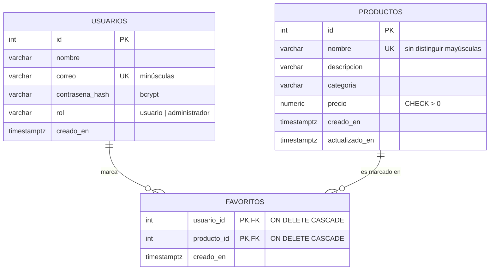

# Catálogo de productos con favoritos y acceso por roles

API REST construida con **Node.js + Express + PostgreSQL** que gestiona un catálogo de productos y la lista de favoritos personal de cada usuario. Usa **autenticación JWT** con vencimiento y **autorización por roles** (`usuario` y `administrador`). Las pruebas se ejecutan con una colección de **Postman** que tiene aserciones en cada petición. El script `npm run test:postman` corre esa colección con Newman y reinicia el servidor a mitad de la ejecución para comprobar la persistencia.

> Proyecto académico. Todos los datos de ejemplo (productos, correos, nombres) son ficticios.

---

## Contenido

1. [Integrantes](#integrantes)
2. [Propósito](#propósito)
3. [Elección de base de datos](#elección-de-base-de-datos)
4. [Requisitos](#requisitos)
5. [Instalación](#instalación)
6. [Variables de entorno](#variables-de-entorno)
7. [Inicialización de datos y del administrador](#inicialización-de-datos-y-del-administrador)
8. [Comandos de ejecución](#comandos-de-ejecución)
9. [Rutas de la API](#rutas-de-la-api)
10. [Formato de respuestas y códigos de estado](#formato-de-respuestas-y-códigos-de-estado)
11. [Modelo de datos](#modelo-de-datos)
12. [Organización del proyecto](#organización-del-proyecto)
13. [Seguridad](#seguridad)
14. [Pruebas](#pruebas)
15. [Aportes de los integrantes](#aportes-de-los-integrantes)
16. [Recursos y herramientas de apoyo](#recursos-y-herramientas-de-apoyo)

---

## Integrantes

| Integrante | Usuario de GitHub | Responsabilidad principal |
|---|---|---|
| `Apellido1 Nombre1` | `usuario-github-1` | Base de datos, CRUD de productos, validaciones |
| `Apellido2 Nombre2` | [aonac70](https://github.com/aonac70) | Autenticación JWT, roles, favoritos, pruebas de seguridad |

> Reemplacen los nombres entre comillas invertidas por los nombres completos antes de entregar.

## Propósito

Ofrecer un backend que permita:

- **Consultar el catálogo** sin iniciar sesión, con filtro por categoría.
- **Administrar productos** (crear, actualizar, eliminar), operación reservada al rol `administrador`.
- **Registrar usuarios e iniciar sesión** para obtener un JWT con vencimiento.
- **Gestionar favoritos personales**: cada usuario autenticado agrega, lista y quita sus favoritos, sin acceso a los de otros usuarios.

## Elección de base de datos

Se eligió **PostgreSQL con el driver `pg`** (y no MongoDB). Los motivos:

| Necesidad del proyecto | Cómo la resuelve PostgreSQL |
|---|---|
| Relación N:M usuario ↔ producto (favoritos) | Tabla `favoritos` con **llaves foráneas** hacia `usuarios` y `productos`. |
| Favoritos sin duplicados | **Llave primaria compuesta** `(usuario_id, producto_id)`. |
| Correo único | Restricción `UNIQUE (correo)` + `CHECK (correo = lower(correo))`. |
| Precio mayor que cero | `CHECK (precio > 0)` y tipo exacto `NUMERIC(10,2)` (sin errores de redondeo). |
| Consistencia al eliminar un producto | `ON DELETE CASCADE`: sus favoritos se eliminan en la misma operación. |
| Evitar inyección SQL | Consultas **parametrizadas** (`$1, $2, …`) en todo el proyecto. |

Las reglas se validan dos veces: en la API (mensajes claros para el cliente) y en la base de datos, que es la última garantía de consistencia aunque alguien escriba directamente en ella.

## Requisitos

| Herramienta | Versión | Notas |
|---|---|---|
| [Node.js](https://nodejs.org/) | **20.12 o superior** (probado con 24) | Incluye npm. |
| [PostgreSQL](https://www.postgresql.org/download/) | 14 o superior (probado con 16) | **O bien** Docker Desktop para usar `docker-compose.yml`. |
| [Postman](https://www.postman.com/downloads/) | Cualquiera reciente | Para la demostración manual. Las pruebas automáticas usan Newman (incluido como dependencia de desarrollo). |
| Git | Cualquiera | Para clonar el repositorio. |

## Instalación

```bash
# 1. Clonar e instalar dependencias exactamente como en package-lock.json
git clone https://github.com/aonac70/DW_TAREA2.git
cd DW_TAREA2
npm ci

# 2. Crear el archivo de configuración a partir del ejemplo
cp .env.example .env              # Windows PowerShell: Copy-Item .env.example .env
```

Edite `.env` y complete como mínimo `DB_PASSWORD`, `JWT_SECRET` y `ADMIN_CONTRASENA`. Para generar un secreto JWT seguro:

```bash
node -e "console.log(require('crypto').randomBytes(48).toString('hex'))"
```

**3. Base de datos.** Elija una opción:

- **Opción A, PostgreSQL instalado localmente.** En `.env` ponga el usuario y la contraseña de su servidor (por ejemplo `DB_USER=postgres`). No necesita crear la base a mano: si `DB_NAME` no existe, `npm run db:init` la crea.
- **Opción B, Docker.** Con los valores de `.env` levanta un PostgreSQL 16 con volumen persistente:

  ```bash
  docker compose up -d
  ```

  Si el puerto 5432 ya está ocupado, cambie `DB_PORT` en `.env` (por ejemplo `5433`) antes de ejecutar el comando.

**4. Inicializar tablas, productos de ejemplo y administrador.**

```bash
npm run db:setup
```

**5. Iniciar la API.**

```bash
npm start            # producción/demostración
npm run dev          # desarrollo: se reinicia al guardar cambios
```

La API queda disponible en `http://localhost:3000/api`. Compruebe el estado con `GET http://localhost:3000/api/salud`.

## Variables de entorno

Se definen en `.env`, que nunca se sube al repositorio. La plantilla sin valores reales es [`.env.example`](.env.example). La configuración se valida al arrancar ([src/config/env.js](src/config/env.js)): si falta una variable o su formato no es válido, el proceso se detiene con un mensaje claro.

| Variable | Obligatoria | Por defecto | Descripción |
|---|---|---|---|
| `NODE_ENV` | No | `development` | `development`, `production` o `test`. |
| `PORT` | No | `3000` | Puerto HTTP de la API. |
| `CORS_ORIGIN` | No | `*` | Orígenes permitidos (lista separada por comas). |
| `DB_HOST` | No | `localhost` | Servidor PostgreSQL. |
| `DB_PORT` | No | `5432` | Puerto de PostgreSQL. |
| `DB_NAME` | Sí | — | Nombre de la base (letras, números y `_`). |
| `DB_USER` | Sí | — | Usuario de PostgreSQL. |
| `DB_PASSWORD` | Sí | — | Contraseña de PostgreSQL. |
| `JWT_SECRET` | Sí | — | Secreto de firma HS256, de **32 caracteres o más**. |
| `JWT_EXPIRES_IN` | No | `1h` | Vigencia del token: `15m`, `1h`, `1d`… |
| `BCRYPT_SALT_ROUNDS` | No | `10` | Costo de bcrypt (10–14). |
| `ADMIN_NOMBRE` | Para `db:admin` | — | Nombre del administrador inicial. |
| `ADMIN_CORREO` | Para `db:admin` | — | Correo del administrador inicial. |
| `ADMIN_CONTRASENA` | Para `db:admin` | — | Contraseña del administrador (8+ caracteres, letras y números). |
| `PUERTO_PRUEBAS` | No | `3100` | Puerto del servidor temporal de `npm run test:postman`. |

## Inicialización de datos y del administrador

| Comando | Qué hace |
|---|---|
| `npm run db:init` | Crea la base si no existe, aplica [db/schema.sql](db/schema.sql) y carga los **10 productos de ejemplo** de [db/seed.sql](db/seed.sql). Se puede repetir sin duplicar datos. |
| `npm run db:admin` | Ejecuta [scripts/crear-admin.js](scripts/crear-admin.js): crea el administrador con `ADMIN_NOMBRE`, `ADMIN_CORREO` y `ADMIN_CONTRASENA` (o lo actualiza si el correo ya existe). |
| `npm run db:setup` | `db:init` + `db:admin`. |
| `npm run db:reset` | **Borra** las tablas y las vuelve a crear con los datos de ejemplo. Está bloqueado con `NODE_ENV=production`. |

**El rol administrador solo se obtiene con este procedimiento local.** El registro público (`POST /api/auth/registro`) siempre crea usuarios con rol `usuario`: si el cliente envía `"rol": "administrador"`, el campo se descarta y el rol se fija en el servidor.

## Comandos de ejecución

| Comando | Descripción |
|---|---|
| `npm start` | Inicia la API. |
| `npm run dev` | Inicia la API en modo desarrollo (`node --watch`). |
| `npm run db:setup` | Inicializa la base de datos y el administrador. |
| `npm run test:postman` | Ejecuta todas las pruebas de Postman con Newman, **reiniciando el servidor** para comprobar la persistencia. |
| `npm run token:vencido` | Imprime un JWT ya vencido para la prueba manual de 401 en Postman. |
| `npm run lint` | Analiza el código con ESLint. |

## Rutas de la API

Prefijo: **`/api`**. Detalle completo de cuerpos, respuestas y errores en **[docs/API.md](docs/API.md)**.

| Método | Ruta | Acceso | Propósito | Éxito | Errores posibles |
|---|---|---|---|---|---|
| GET | `/` | Público | Información de la API y lista de rutas (`GET /` en la raíz redirige aquí) | 200 | — |
| GET | `/salud` | Público | Estado de la API y de la base de datos | 200 | 503 |
| POST | `/auth/registro` | Público | Registrar un usuario (siempre rol `usuario`) | 201 | 400, 409, 422 |
| POST | `/auth/login` | Público | Validar credenciales y emitir JWT | 200 | 400, 401, 422 |
| GET | `/productos?categoria=` | Público | Listar productos; filtro opcional por categoría | 200 | 400 |
| GET | `/productos/:id` | Público | Consultar un producto | 200 | 400, 404 |
| POST | `/productos` | Administrador | Crear un producto | 201 | 400, 401, 403, 409, 422 |
| PUT | `/productos/:id` | Administrador | Actualizar (reemplazar) un producto | 200 | 400, 401, 403, 404, 409, 422 |
| DELETE | `/productos/:id` | Administrador | Eliminar un producto (y sus favoritos) | 204 | 400, 401, 403, 404 |
| GET | `/favoritos` | Autenticado | Listar los favoritos propios | 200 | 401 |
| POST | `/favoritos` | Autenticado | Agregar `{ "productoId": n }` a sus favoritos | 201 | 400, 401, 404, 409, 422 |
| DELETE | `/favoritos/:productoId` | Autenticado | Quitar un producto de sus favoritos | 204 | 400, 401, 404 |

Las rutas protegidas requieren la cabecera `Authorization: Bearer <token>`.

## Formato de respuestas y códigos de estado

Todas las respuestas son JSON con una forma fija:

```jsonc
// Éxito con un recurso
{ "data": { "id": 1, "nombre": "…" } }

// Éxito con una lista
{ "data": [ … ], "meta": { "total": 10, "categoria": null } }

// Error
{
  "error": {
    "estado": 422,
    "codigo": "VALIDACION_FALLIDA",
    "mensaje": "Los datos enviados no son válidos.",
    "detalles": [ { "campo": "precio", "mensaje": "El campo 'precio' debe ser mayor que cero." } ]
  }
}
```

| Código | Uso en esta API |
|---|---|
| **200** | Consultas y actualizaciones exitosas; inicio de sesión. |
| **201** | Creación (registro, producto, favorito). Al crear un producto se incluye la cabecera `Location`. |
| **204** | Eliminación exitosa (producto o favorito), sin cuerpo. |
| **400** | La petición está mal formada (ver criterio abajo). |
| **401** | Falta el token, está vencido, mal formado o alterado; o las credenciales son incorrectas. Incluye `WWW-Authenticate: Bearer`. |
| **403** | Hay token válido, pero el rol no permite la operación (un `usuario` intentando modificar el catálogo). |
| **404** | El producto, el favorito o la ruta no existen. |
| **409** | Duplicado: correo ya registrado, producto con el mismo nombre o favorito repetido. |
| **422** | JSON válido cuyo contenido no cumple las reglas. |
| **500** | Error inesperado. Mensaje genérico: la traza solo se registra en el servidor. |

### Criterio 400 vs 422

- **400 Bad Request: la petición en sí está mal formada** y no se puede interpretar.
  - JSON con errores de sintaxis → `JSON_INVALIDO`.
  - Cuerpo que no es un objeto JSON, o enviado sin `Content-Type: application/json` → `CUERPO_INVALIDO`.
  - Parámetro de ruta inválido, por ejemplo `/productos/abc` → `PARAMETRO_INVALIDO`.
  - Filtro de consulta inválido, por ejemplo `?categoria=` vacío → `FILTRO_INVALIDO`.
- **422 Unprocessable Entity: el JSON se entendió, pero sus datos no cumplen las reglas de negocio** → `VALIDACION_FALLIDA` con `detalles` por campo.
  - Campos obligatorios ausentes o vacíos.
  - Correo con formato inválido, contraseña débil.
  - Precio `<= 0`, no numérico o con más de 2 decimales.
  - `productoId` no entero.

Todos los mensajes de error son claros y nunca incluyen trazas, SQL, secretos ni detalles internos ([src/middlewares/manejadorErrores.js](src/middlewares/manejadorErrores.js)).

## Modelo de datos



**¿Qué ocurre con los favoritos al eliminar un producto?** Se eliminan automáticamente gracias a `ON DELETE CASCADE` en `favoritos.producto_id`, así ningún usuario queda con favoritos que apunten a un producto inexistente. Esto se comprueba en la carpeta *08 Consistencia al eliminar un producto* de la colección. Lo mismo sucede si se elimina un usuario.

El script completo está en [db/schema.sql](db/schema.sql).

## Organización del proyecto

```
catalogo-api/
├── db/
│   ├── schema.sql            # Tablas, restricciones e índices (idempotente)
│   ├── seed.sql              # 10 productos ficticios
│   └── reset.sql             # Borrado de tablas (solo db:reset)
├── docs/                     # API, pruebas, guion del video, plan de trabajo
├── postman/
│   ├── Catalogo.postman_collection.json
│   └── Catalogo.postman_environment.json   # Entorno de ejemplo SIN secretos
├── scripts/
│   ├── db-init.js            # Crea la base, aplica el esquema y los datos de ejemplo
│   ├── crear-admin.js        # Crea el administrador desde .env
│   ├── token-vencido.js      # Genera un JWT vencido para la prueba de 401
│   └── pruebas-postman.js    # Newman + reinicio real del servidor
├── src/
│   ├── config/               # env.js (variables validadas), roles.js
│   ├── db/                   # pool.js (conexión), erroresPg.js (códigos SQLSTATE)
│   ├── routes/               # Rutas: URL + middlewares → controlador
│   ├── middlewares/          # autenticar, autorizar, validar, manejadorErrores, rutaNoEncontrada
│   ├── validators/           # Esquemas Zod (lista blanca de campos)
│   ├── controllers/          # Capa HTTP: lee req, llama al servicio, responde
│   ├── services/             # Reglas de negocio (hash, JWT, duplicados, 404/409)
│   ├── repositories/         # Acceso a datos: SQL parametrizado
│   ├── utils/                # errores HTTP, respuestas, jwt
│   ├── app.js                # Configuración de Express
│   └── server.js             # Arranque y cierre ordenado
├── .env.example  ·  .gitignore  ·  docker-compose.yml  ·  eslint.config.js
└── package.json  ·  package-lock.json
```

**Recorrido de una petición** (ejemplo: `POST /api/favoritos`):

```
Postman ─► routes/favoritos.routes.js
            ├─ middlewares/autenticar.js   verifica el JWT → req.usuario = { id, rol }
            ├─ middlewares/validar.js      valida { productoId } con Zod → req.validado.body
            └─ controllers/favoritos.controller.js
                 └─ services/favoritos.service.js        traduce 23505→409 y 23503→404
                      └─ repositories/favoritos.repository.js   INSERT … VALUES ($1, $2)
                           └─ PostgreSQL ─► fila ─► { "data": { … } } con 201
```

## Seguridad

- **Contraseñas** con hash **bcrypt** (costo configurable). Ninguna respuesta incluye la contraseña ni su hash: los repositorios seleccionan columnas explícitas y los mapeadores construyen cada objeto.
- **JWT HS256** con `sub` (id), `rol`, `iss`, `aud` y `exp`. Al verificar se exigen la firma, el algoritmo (evita `alg: none`), el emisor, la audiencia y la **expiración**.
- **Identidad desde el token**: favoritos usa siempre `req.usuario.id`. Un `usuarioId` enviado por el cliente se descarta.
- **Lista blanca de campos** con Zod: solo los campos declarados llegan a la base de datos (no hay asignación masiva).
- **Login sin enumeración de usuarios**: el mismo mensaje y un tiempo de respuesta similar tanto si el correo no existe como si la contraseña es incorrecta.
- **SQL parametrizado** en todas las consultas.
- **Helmet** (cabeceras de seguridad), **CORS** configurable y límite de **10 kB** por cuerpo JSON.
- **Secretos fuera del repositorio**: `.env` está en `.gitignore`. El entorno de Postman de ejemplo no contiene contraseñas ni tokens.

## Pruebas

La colección [postman/Catalogo.postman_collection.json](postman/Catalogo.postman_collection.json) tiene **74 peticiones** en 10 carpetas, cada una con aserciones de código HTTP y de campos de la respuesta. Además, aserciones **globales** comprueban en cada respuesta que el formato sea JSON, que los errores sean consistentes y que no aparezcan contraseñas, hashes ni detalles internos.

| Carpeta | Casos obligatorios que demuestra |
|---|---|
| 00 Preparación | Salud de la API y de la base de datos |
| 01 Autenticación | Registro y login correctos; correo duplicado (409); credenciales incorrectas (401); datos inválidos (422); rol administrador ignorado en el registro |
| 02 Catálogo público | Consulta sin token y filtro por categoría |
| 03 CRUD de productos | Crear (201), consultar, actualizar (200), filtrar y eliminar (204) como administrador |
| 04 Validaciones y errores | Precio inválido y campos vacíos (422); JSON mal formado e id inválido (400); producto inexistente (404); nombre duplicado (409) |
| 05 Seguridad: 401 y 403 | Sin token, token vencido y token manipulado (401); catálogo modificado con rol usuario (403) |
| 06 Favoritos | Crear, consultar y eliminar; duplicado (409); producto inexistente (404) |
| 07 Aislamiento A/B | B no ve ni puede quitar los favoritos de A; el favorito de A permanece; `usuarioId` del cliente ignorado |
| 08 Consistencia | Al eliminar un producto sus favoritos desaparecen (cascada) |
| 09 Persistencia | Tras reiniciar Node.js: proceso nuevo, usuarios, producto y favoritos siguen en la base |

### Opción 1: automática (recomendada)

Con PostgreSQL en marcha y `npm run db:setup` ya ejecutado (no hace falta que la API esté corriendo):

```bash
npm run test:postman
```

El script inicia la API en el puerto `PUERTO_PRUEBAS`, ejecuta las carpetas 00–08 y **detiene el proceso de Node.js**. Luego arranca uno nuevo y ejecuta la carpeta 09 con los ids de la primera fase. El resumen queda en `reportes/resultados-pruebas.md`. Los resultados obtenidos están en [docs/PRUEBAS.md](docs/PRUEBAS.md).

### Opción 2: manual en Postman (para la demostración)

1. **Import** → seleccione los dos archivos de la carpeta `postman/` y active el entorno *Catálogo API - Local (ejemplo)*.
2. En el entorno, escriba en **Current value**:
   - `adminContrasena`: el valor de `ADMIN_CONTRASENA` de su `.env`.
   - `tokenVencido`: la salida de `npm run token:vencido`.
3. Inicie la API con `npm start`.
4. Abra el **Runner**, desmarque la carpeta *09* y ejecute las carpetas 00 a 08 en orden.
5. **Reinicie el servidor**: `Ctrl + C` y luego `npm start`.
6. Ejecute solo la carpeta *09 Persistencia tras reinicio*. La primera prueba comprueba que `iniciadoEn` cambió (proceso nuevo) y las demás, que los datos siguen ahí.

La colección se puede ejecutar varias veces: cada corrida genera correos y nombres únicos.

### Verificación desde una copia limpia

```bash
git clone https://github.com/aonac70/DW_TAREA2.git prueba-limpia
cd prueba-limpia
npm ci
cp .env.example .env     # completar valores
npm run db:setup
npm run test:postman
```

## Aportes de los integrantes

| Integrante | Aportes |
|---|---|
| `Apellido1 Nombre1` | Esquema SQL y datos de ejemplo, conexión a PostgreSQL, CRUD de productos (repositorio, servicio, controlador y rutas), validaciones de productos, carpetas 02–04 de Postman. |
| `Apellido2 Nombre2` | Registro e inicio de sesión, JWT, middlewares de autenticación y autorización, script del administrador, favoritos, carpetas 01 y 05–09 de Postman, script de pruebas con reinicio. |
| Ambos | Manejo de errores, README, revisión de código y video. |

El detalle de la división del trabajo y de los commits está en [docs/PLAN_DE_TRABAJO.md](docs/PLAN_DE_TRABAJO.md).

## Recursos y herramientas de apoyo

- [Documentación de Express 5](https://expressjs.com/en/5x/api.html): enrutamiento, middlewares y manejo de errores asíncronos.
- [node-postgres (`pg`)](https://node-postgres.com/): pool de conexiones y consultas parametrizadas.
- [Documentación de PostgreSQL](https://www.postgresql.org/docs/current/): restricciones, `ON DELETE CASCADE`, `GENERATED AS IDENTITY` y [códigos de error SQLSTATE](https://www.postgresql.org/docs/current/errcodes-appendix.html).
- [jsonwebtoken](https://github.com/auth0/node-jsonwebtoken): firma y verificación de JWT. [RFC 7519 (JWT)](https://datatracker.ietf.org/doc/html/rfc7519) y [RFC 6750 (Bearer)](https://datatracker.ietf.org/doc/html/rfc6750).
- [bcryptjs](https://github.com/dcodeIO/bcrypt.js): hash de contraseñas.
- [Zod](https://zod.dev/): validación de entradas.
- [Helmet](https://helmetjs.github.io/) y [cors](https://github.com/expressjs/cors).
- [Postman: escritura de pruebas](https://learning.postman.com/docs/tests-and-scripts/write-scripts/test-scripts/) y [Newman](https://github.com/postmanlabs/newman).
- [OWASP Authentication Cheat Sheet](https://cheatsheetseries.owasp.org/cheatsheets/Authentication_Cheat_Sheet.html): mensajes genéricos de login y almacenamiento de contraseñas.
- **Asistente de IA (Claude, de Anthropic)**: se usó como apoyo para estructurar el proyecto, revisar buenas prácticas y redactar la documentación. El equipo revisó, ejecutó y comprende todo el código incorporado, y lo explica en el video.

## Licencia

Uso académico. Distribuido bajo licencia MIT.
